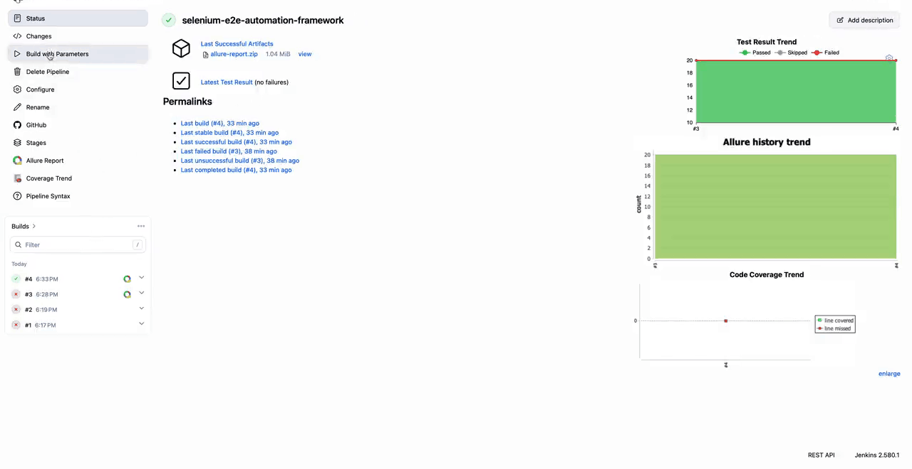

# Selenium E2E Automation Framework


A complete end-to-end test automation framework built with **Selenium WebDriver 4**, **Java 17**, **Cucumber BDD**, **JUnit 5**, and **Allure** reporting. It tests the [Swag Labs](https://www.saucedemo.com) demo store (15 UI journeys, written as Cucumber scenarios) and the [ReqRes](https://reqres.in) practice API (5 REST Assured tests).

**Watch it run** — the Jenkins pipeline: Build Now → stages go green → Allure report, 20/20:



If you are new to test automation, this repo is written for you: every class has comments explaining what it does and why, test names say what they check in plain words, and the setup below assumes you are starting from scratch.

## What is tested

**UI tests** (`src/test/resources/features/` + `src/test/java/steps/`) — 15 journeys against Swag Labs, written as Cucumber scenarios in plain words. The step definitions in `steps/` are thin wrappers over the page objects in `pages/`; the scenarios themselves contain no code, only the journey:

| Area | Tests | What is covered |
|---|---|---|
| Login | 5 | Standard login, locked-out user, problem user (broken images), slow user, wrong credentials |
| Inventory | 6 | Product listing, sorting (name A–Z, Z–A, price low–high, high–low), cart badge |
| Cart | 2 | Items appear with correct names/prices, removing empties the cart |
| Checkout | 2 | Order summary totals ($39.98 / $3.20 / $43.18), order confirmation page |

**API tests** (`src/test/java/api/`) — 5 tests against ReqRes with REST Assured:

| Test | What it checks |
|---|---|
| Getting one user | 200 with the expected name and email |
| Getting the user list | 200 with paginated data (page, per_page, total) |
| Creating a user | 201 with an id and creation timestamp |
| Updating a user | 200 with an updated timestamp |
| Deleting a user | 204 with an empty body |

## Prerequisites

- **Java 17+** (Temurin recommended)
- **Maven 3.9+**
- **Chrome or Chromium** — Selenium Manager (built into Selenium 4) downloads the matching *driver* automatically; you only need the browser itself installed.

Run the preflight script to check all of this — it installs what is missing on macOS/Linux:

```bash
bash scripts/preflight.sh
```

The same script runs automatically every time you run `mvn test` (bound to Maven's `validate` phase). Skip it with `mvn test -Dpreflight.skip=true`.

## Quickstart

```bash
# 1. Clone and enter the repo
git clone https://github.com/acbharath14/selenium-e2e-automation-framework.git
cd selenium-e2e-automation-framework

# 2. Run everything (UI + API)
mvn test

# 3. Run only the UI tests (the Cucumber scenarios)
mvn test -Dtest="CucumberTest"

# 4. Run only the API tests
mvn test -Dtest="ReqResApiTest"

# 5. Run headless (no browser window — for CI or servers)
mvn test -Dheadless=true

# 6. Run one feature file
mvn test -Dtest="CucumberTest" -Dcucumber.features=src/test/resources/features/login.feature
```

The first run downloads dependencies and the Chrome driver via Selenium Manager. UI tests take a few minutes (one browser per test); API tests finish in seconds.

## Project structure

```
├── pom.xml                        # Dependencies: Selenium 4, Cucumber, JUnit 5, Allure, JaCoCo, REST Assured
├── scripts/preflight.sh           # Setup checker — runs automatically before tests
├── Jenkinsfile                    # Jenkins declarative pipeline (CI option 1)
├── ci/github-actions.yml          # GitHub Actions workflow TEMPLATE (CI option 2)
└── src/test/
    ├── java/
    │   ├── factory/
    │   │   └── WebDriverFactory.java   # Creates Chrome instances (Selenium Manager drivers)
    │   ├── pages/                      # Page Objects — one class per page, all selectors here
    │   │   ├── LoginPage.java
    │   │   ├── InventoryPage.java
    │   │   ├── CartPage.java
    │   │   └── CheckoutPage.java
    │   ├── runner/
    │   │   └── CucumberTest.java       # JUnit Platform Suite that runs the .feature files
    │   ├── steps/                      # Step definitions + hooks — thin wrappers over page objects
    │   │   ├── World.java              # Shared scenario state (the browser + page objects)
    │   │   ├── Hooks.java              # Fresh browser per scenario, screenshot on failure
    │   │   ├── LoginSteps.java
    │   │   ├── InventorySteps.java
    │   │   ├── CartSteps.java
    │   │   └── CheckoutSteps.java
    │   ├── api/                        # API test classes (REST Assured, no browser)
    │   │   └── ReqResApiTest.java
    │   └── util/
    │       └── TestData.java           # Loads users.json / products.json
    └── resources/
        ├── features/                   # Cucumber scenarios, one file per journey area
        │   ├── login.feature
        │   ├── inventory.feature
        │   ├── cart.feature
        │   └── checkout.feature
        ├── users.json                  # Login credentials matrix
        └── products.json               # Product catalog + checkout totals
```

**Key design rules:**

- **Scenarios read like the user story** — the `.feature` files say what the user does and what should happen, in plain words. Step definitions are thin wrappers over page objects; the feature files contain no code and no selectors.
- **Page Object Model** — every page has one class holding its selectors and actions. Step definitions call page methods; they never touch `driver.findElement` directly.
- **Explicit waits only** — `WebDriverWait` everywhere, no `Thread.sleep`. Each page object carries its own 10-second wait.
- **Test data in JSON** — credentials and expected values live in `src/test/resources/`, loaded by `TestData`. Add a user or product there, not in code.
- **Fresh browser per scenario** — the `Hooks` class starts Chrome before each scenario and quits after. Scenarios never share state.
- **UI and API stay separate** — the Cucumber scenarios drive Selenium, `api/` is REST Assured. They share nothing but the build.

## Test reports

**Allure** (the execution report — who passed, who failed, with screenshots):

```bash
mvn test                       # results land in target/allure-results/
mvn allure:serve                # opens the interactive report in your browser
```

Failed scenarios attach a screenshot to the Allure report and also save it under `target/screenshots/`. The Allure report lists each Cucumber scenario as a test case.

**JaCoCo** (the coverage report — which framework code the tests exercised):

```bash
mvn test                       # report lands in target/site/jacoco/
open target/site/jacoco/index.html
```

## CI setup

Two CI options are supported — pick the one that fits your environment.

### Option 1: Jenkins

CI runs on Jenkins via the `Jenkinsfile` at the repo root (declarative pipeline).

**Jenkins prerequisites:**
1. A Jenkins agent with **JDK 17**, **Maven 3**, and **Chrome** installed.
   - Note: the Jenkins **controller** itself needs **Java 21+** to run (Jenkins 2.580+ refuses to start on Java 17). The builds still use JDK 17 — controller Java and build JDK are separate settings.
2. In Jenkins → Manage Jenkins → Tools, define:
   - JDK installation named `jdk-17`
   - Maven installation named `maven-3`
3. Install the **Allure** and **JaCoCo** plugins for report publishing.
   - The Allure plugin auto-installs Allure **3.x** (redesigned UI). If you prefer the classic Suites / Categories / Timeline tabs, set the Allure Commandline tool version to **2.34.1** under Manage Jenkins → Tools.

**Pipeline stages:** Checkout → Preflight (`scripts/preflight.sh`) → Test (`mvn clean test`).

The `HEADLESS` build parameter (default `true`) controls Chrome headless mode. Post-build publishes JUnit trends, the Allure report, JaCoCo coverage, and archives failure screenshots.

### Option 2: GitHub Actions

The GitHub Actions workflow lives at `ci/github-actions.yml` as a **template** — it is not wired up automatically. To enable CI:

1. On GitHub, go to **Add file → Create new file**.
2. Name it `.github/workflows/selenium.yml`.
3. Paste the contents of `ci/github-actions.yml` (keep the quotes around `"on"` — YAML treats a bare `on` as `true`).
4. Commit. The workflow runs on every push/PR to `main`, plus manually.

It runs the suite headless on Ubuntu, then uploads three artifacts: the Allure report, the JaCoCo report, and failure screenshots.

## Extending the framework

- **New page?** Add a class in `pages/` with its selectors as `private static final By` fields and public action methods.
- **New UI journey?** Add a scenario to the matching `.feature` file (title says what the user does and what should happen, in plain words), then add the steps to the matching class in `steps/`.
- **New API test?** Add a method to `api/ReqResApiTest.java` (or a new class in `api/`) using REST Assured's `given/when/then`.
- **New test data?** Edit `users.json` / `products.json` and read it via `TestData`.

## License

MIT — see [LICENSE](LICENSE).

